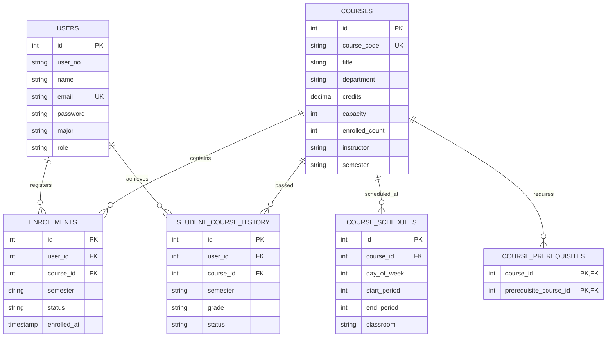

# University Course Selection — Usage & Architecture Guide

## 1. Application Overview

This relational database-backed application focuses on course selection and its essential helper features:

1. **View Selectable Courses**: Browse all open courses, instructor details, department filters, and real-time seat capacities.
2. **View Selected Courses**: Inspect active course registrations for the semester.
3. **Adjust Selected Courses**: Add or drop courses dynamically with transactional consistency.
4. **Mandatory Constraint Enforcement**:
   * **Constraint 1 (Prerequisites)**: Ensures prerequisite foundation courses have been completed and passed before allowing enrollment in advanced courses.
   * **Constraint 2 (Credit Limit)**: Enforces an institutional hard ceiling of **no more than 21 credits in one semester**.
   * **Constraint 3 (No Time Conflicts)**: Prevents schedule overlaps between courses meeting on the same day and time periods.

---

## 2. Relational Database Architecture

The system uses a 3NF normalized relational schema implemented with JDBC.



### Table Definitions:
1. `users`: Stores student accounts, identification numbers, and role permissions.
2. `courses`: Course catalog, unit credits (including 0.5- and 1-credit workshops), and capacity.
3. `course_schedules`: Time slots where `day_of_week` (1=Mon ... 5=Fri) and periods (1 to 12) define exact meeting windows.
4. `course_prerequisites`: Self-referential relationship modeling which courses require prior course completion.
5. `student_course_history`: Historical academic transcript recording completed semesters and passing grades.
6. `enrollments`: Current active semester course registrations.

---

## 3. Mathematical & Algorithmic Constraint Enforcement

### 3.1 Constraint 1: Prerequisite Verification
Before inserting an enrollment record into `enrollments`:
$$\forall p \in \text{Prerequisites}(C_{\text{target}}), \quad \exists h \in \text{History}(U) \text{ such that } h.\text{courseId} = p \land h.\text{status} = \text{'PASSED'}$$
If any required prerequisite $p$ is missing from the student's passed history, the transaction is rejected with an HTTP 400 error:
> *"Prerequisite constraint violation: You must first pass prerequisite course [CS201 Data Structures] before selecting [CS202 Database Systems]."*

### 3.2 Constraint 2: Credit Limit ($\le 21$ Credits)
Let $E_U$ be the set of currently enrolled courses for student $U$:
$$\text{CurrentCredits}(U) = \sum_{c \in E_U} c.\text{credits}$$
$$\text{Condition: } \text{CurrentCredits}(U) + C_{\text{target}}.\text{credits} \le 21$$
If the sum exceeds 21:
> *"Credit ceiling exceeded: Your current enrolled credits (19) + course credits (3) = 22 credits, which exceeds the mandatory maximum limit of 21 credits per semester."*

### 3.3 Constraint 3: Timetable Collision Detection
Two time slots $S_1$ and $S_2$ collide if and only if:
$$(S_1.\text{dayOfWeek} = S_2.\text{dayOfWeek}) \land \neg(S_1.\text{endPeriod} < S_2.\text{startPeriod} \lor S_1.\text{startPeriod} > S_2.\text{endPeriod})$$
If any slot of $C_{\text{target}}$ collides with any slot of an already enrolled course:
> *"Schedule conflict detected: Course [CS301] overlaps with already selected course [CS101] on Monday Period 1-2."*

---

## 4. Preloaded Test Accounts & Verification Walkthrough

The relational database initializes with built-in test records demonstrating all constraints:

### Student 1: Li Wei (`li.wei@jnu.edu.cn` / `student123`)
* **Cohort**: 2025 (second year in the current 2026 fall term).
* **Academic History**: Has completed one academic year: `CS101`, `CS102`, `MATH201`, `GEN101`, and `SE201`.
* **Prerequisite Test**:
  * Select `CS201 Data Structures` $\rightarrow$ **Allowed** (prerequisite `CS101` is satisfied).
  * Try to select `CS202 Database Systems` $\rightarrow$ **Blocked** (requires `CS201`, which Li Wei hasn't completed).

### Student 2: Omar Hassan (`omar.hassan@jnu.edu.cn` / `student123`)
* **Cohort**: 2024 (third year in the current 2026 fall term).
* **Academic History**: Has completed two academic years, including `CS101`, `CS102`, `CS201`, `CS202`, `CS301`, `SE201`, `SE302`, `AI301`, `MATH201`, and `GEN101`.
* **Advanced Prerequisite Test**:
  * Can select `CS301 Advanced Database` and `AI301 Machine Learning`.
* **Time Conflict Test**:
  * Select `CS101` (Monday Period 1-2).
  * Try to select `CS301` (Monday Period 1-2) $\rightarrow$ **Blocked by schedule clash**.
* **Credit Limit Test**:
  * Enroll in courses totaling 19 credits.
  * Try to add a 3-credit course (total 22) $\rightarrow$ **Blocked by 21-credit ceiling**.

---

## 5. Launch Instructions

### Method A: Single-Click Launcher (Recommended)
1. Navigate to the `proj 2/run/` directory.
2. Double-click `start-all.bat` (or right-click `start-all.ps1` and select *Run with PowerShell*).
3. Open your browser at **`http://localhost:5173`**.

### Method B: Manual CLI Execution
```bash
# Terminal 1: Backend
cd "proj 2/src/backend"
mvn compile exec:java -Dexec.mainClass="com.courseforge.Main"

# Terminal 2: Frontend
cd "proj 2/src/frontend"
npm run dev
```

---

## 6. Project Archive Structure (`E-archives`)

As required by `DBS2026-Project2.pdf`:

```text
Project2_Archive/
├── src/                  # All source code (Java backend, Vite React frontend, SQL DDL)
├── run/                  # Launchable scripts (start-all.bat, run-backend.bat, run-frontend.bat)
└── doc/                  # Complete system documentation (README.md, USAGE_GUIDE.md)
```
Compress these folders into `CST_DBS_P2_YourName.zip` and email to `1023391448@qq.com` before Dec. 25, 2026.
